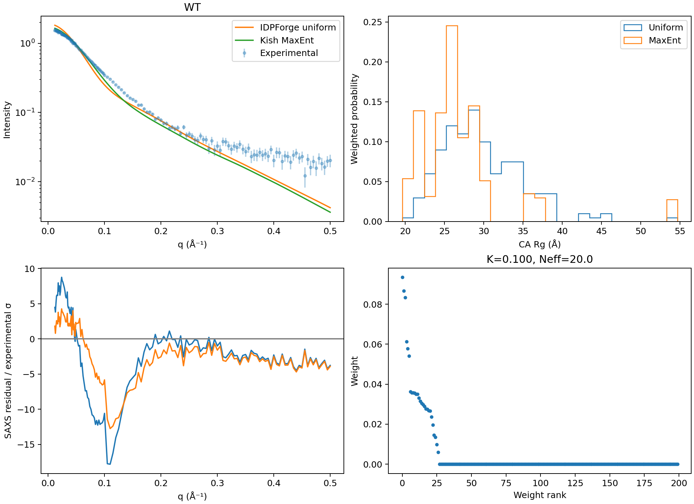
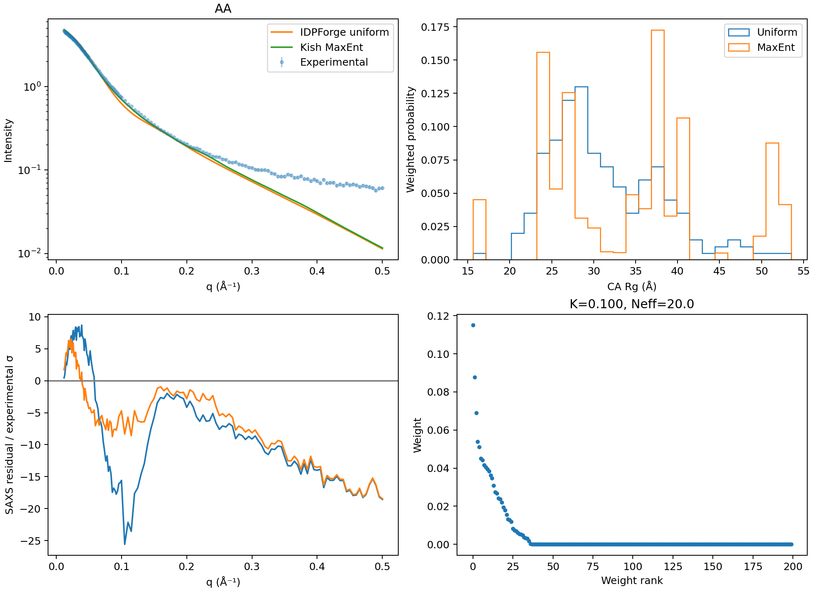
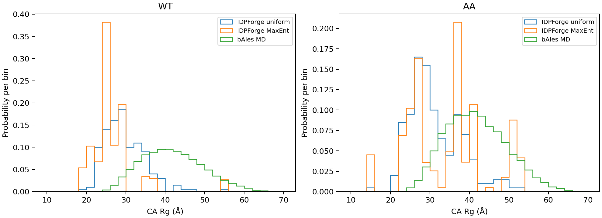
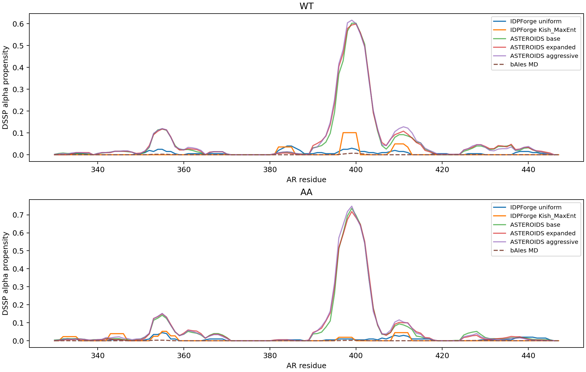
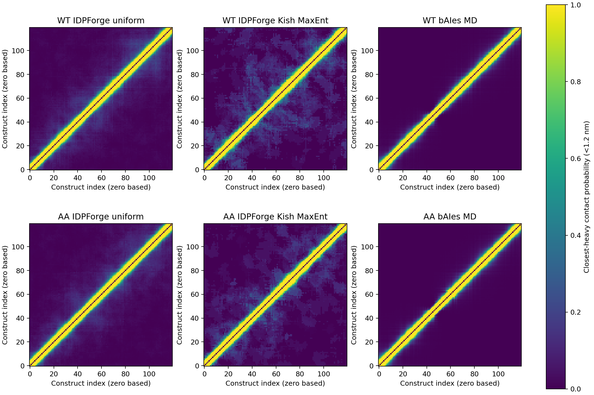
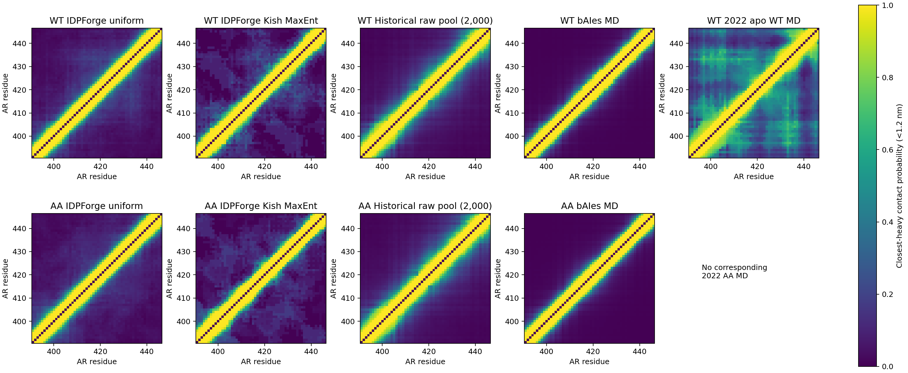

# IDPForge: Borthakur Kish-restrained MaxEnt and ensemble comparisons

The 200 validated IDPForge conformers for each GP–AR330–447 sequence were continuously reweighted using the Borthakur maximum-entropy dual objective, separately calibrated regularization for each measured chemical-shift nucleus and SAXS, and a global calibration preserving normalized Kish ratio ≥0.10. No ASTEROIDS ensemble-selection algorithm was run.

## Main findings

| Variant | CA Rg: uniform → MaxEnt (Å) | Alpha helicity: uniform → MaxEnt (%) | SAXS χ² per point: uniform → MaxEnt | Kish effective count |
|---|---:|---:|---:|---:|
| WT | 29.75 → 26.86 | 0.699 → 0.633 | 37.46 → 16.68 | 20.000 |
| AA | 31.33 → 34.15 | 0.674 → 0.608 | 120.66 → 73.14 | 20.000 |

Reweighting improves some residuals but neither ensemble gives a satisfactory SAXS fit. Carbon-shift RMSEs remain around 0.5 ppm, and N/H residuals remain large. Alpha helicity stays below 1%; the weights do not recover substantial helical populations from this 200-member prior. Meeting the Kish threshold controls weight concentration; it does not certify experimental agreement.

## Protocol and verification

- Source: [paulrobustelli/Borthakur_MaxEnt_IDPs_2024](https://github.com/paulrobustelli/Borthakur_MaxEnt_IDPs_2024), commit `44ef852f64fac7aa04e9c8216cafbafaf9629910`. The dual objective is extracted verbatim from PaaA2/reweighting_examples/reweight_functions.py; its SHA-256 is recorded. The analyst adapter preserves this objective under centering/rescaling and uses gradient checks and converged L-BFGS-B optimization.
- Per-data-type regularization is calibrated first, followed by a global factor. The scan uses logarithmic bracketing/bisection to resolve the Kish boundary instead of only selecting a coarse notebook grid point; minimum scan factor is 0.01. All final weights are finite, nonnegative and normalized; both final Kish ratios exceed 0.10. This is a continuous-weight fit, not selection of 20 PDBs.
- Sampling-error regularization uses IID standard errors over the 200 generated structures, replacing chronological MD block-error estimates. Independence is an assumption for the generated prior; systematic model error is not estimated by this SEM. This explicit adaptation is not a literal application of MD blocking to generated samples.
- WT absolute shifts are from BMRB 53105; AA shifts are from the preserved W397A_W433A.shifty experimental file. Zero placeholders are omitted. Chemical-shift predictions are native SPARTA+ 2.90 tables from the validated Linux runtime. Each experimental residue maps to one-based model residue AR−327: AR330 is model residue 3, after GP. AR447 is excluded as the model C-terminal residue; AR448 is outside the construct. Missing predictions are recorded. All native prediction residue identities were checked against the sequences. The overlapping experimental secondary-shift values reproduce the historical ASTEROIDS snapshot exactly.
- An initial fit had an off-by-one mapping and was rejected before publication. Only the corrected fit is included. Native prediction files did not need regeneration for that correction.
- Native Pepsi-SAXS 3.0 uses the Borthakur calc_saxs.py parameter values `--dro 3.34 --r0_min_factor 1.68 --r0_max_factor 1.68 --r0_N 1`. The r0 CLI setting is reported as a factor, not silently relabeled as an absolute radius in Å. Additional native settings: n=80, no smearing, q grid 0–0.5 Å⁻¹ with 501 points. These settings differ from the historical ASTEROIDS forward model (dro=5, default radius). Native intensities are interpolated to actual experimental q values. Per-conformer weighted least-squares scale factors reproduce the fixed-parameter experimental-profile calculation used by calc_saxs.py: a direct native check differs by <3×10⁻⁶ relative. No additive background is fitted. Because profile scales are fitted per conformer as in that source calculation, this comparison should not be mistaken for a single globally fixed absolute-intensity model.
- Diagonal SAXS errors are used for reported χ²; measured q-point covariance is unavailable. Experiments used for fitting are not independent validation.
- macOS numerical-library matmul operations emitted warnings despite bounded finite inputs and outputs. Reported predictions and χ² were independently recomputed using explicit einsum contractions and match to numerical precision; verification is saved.

## Comparisons and scope

[Experimental-fit comparison](ensemble_comparison.csv) includes unweighted/reweighted IDPForge and all available archived ASTEROIDS base/expanded/aggressive selections. Chemical-shift comparisons use matching residue/nucleus observations. Historical selections used fixed optimization scales, different candidate pools and a different SAXS forward model. Their SAXS χ² values are shown as reported and are not a controlled ranking under one matched forward model. No historical selection was rerun.

[Structural comparison](structural_ensemble_comparison.csv) includes IDPForge before/after, archived ASTEROIDS full-chain and AR391–446 results, previous 2 µs WT/AA bAIes MD observables, and the 2022 apo WT MD summary for AR391–446. CA Rg and backbone S-alpha definitions match the earlier repository analysis. Full-chain S-alpha has 114 windows; AR391–446 has 50; totals are not length-normalized.

The 2022 apo MD is a separately simulated capped WT fragment, not the full GP construct; no corresponding 2022 AA MD is available. Its geometric CA Rg (12.49 Å) and S-alpha (6.55) are compared only in the R2R3 scope. In that scope, IDPForge MaxEnt WT/AA have mean Rg 19.60/22.10 Å and S-alpha 1.91/1.88. The full-chain bAIes MD means are 41.86/41.72 Å with substantially lower helicity. No new experimental backcalculations or reweighting of the MD ensembles were performed here; their structural summaries/maps are reused with provenance.

The historical raw-pool contact maps are uniformly averaged 2,000-member candidate pools, not the ASTEROIDS selected subsets. Contact maps use closest-heavy <1.2 nm, include adjacent pairs and have zero diagonal. All newly calculated maps are finite, symmetric and bounded. Differences in chain context, candidate generation and weights limit mechanistic interpretation.

## Figures

## Reproduction and files

Weights CSVs map directly to the validated conformer filenames in the supplied native_bundle ZIP files. Observable NPZ matrices, regularization scans, fit summaries, mapped observations, exclusions, structural observables/maps and numerical verification files are included. The original source objective and adapters are included; paths assume the recorded workspace layout and must be adjusted when extracting elsewhere. The eight native_bundle ZIP files collectively include the 400 conformers and native prediction tables/curves used in the fit. Environments and emulated runtime binaries are excluded.
