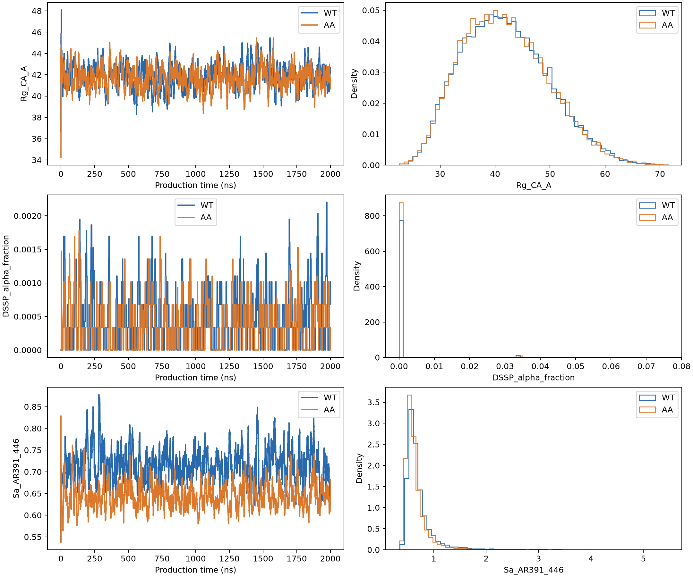
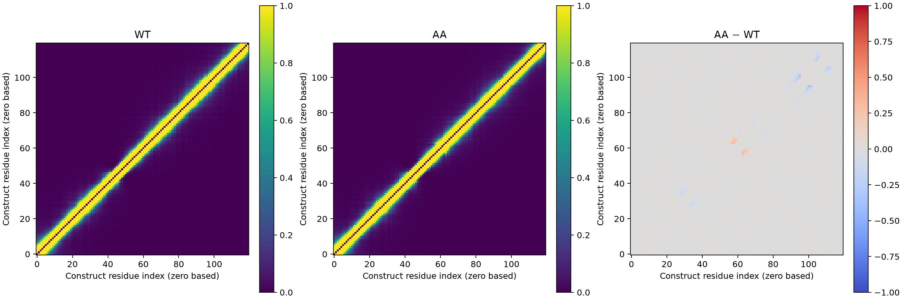
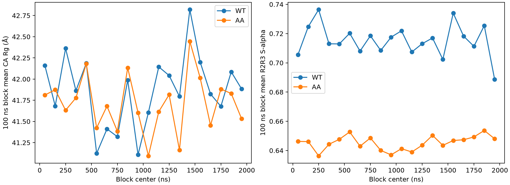
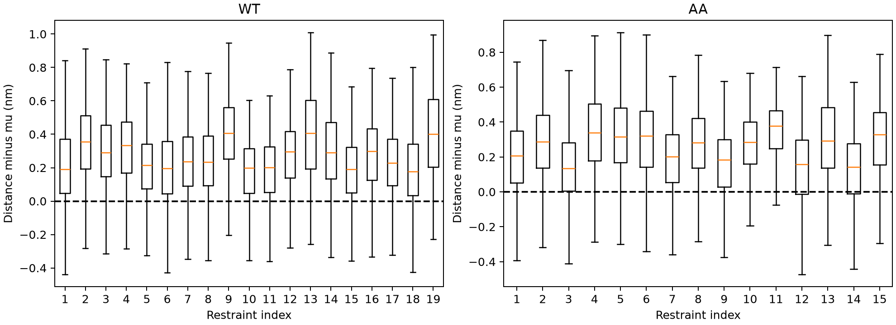

# Tau-5 bAIes: 2 µs WT and AA production results

Both runs completed successfully on the Apple M5 Max GPU using OpenMM 8.6.1, OpenCL single precision, 298.15 K, 2 fs timestep and 0.01 ps⁻¹ Langevin friction. Each run adds exactly 1,000,000,000 steps (2 µs) to its production start. WT ends at step 1,004,695,000 (2009.39 ns); AA ends at 1,004,675,000 (2009.35 ns). Final XML states confirm completion.

## Findings

| Observable | WT mean | AA mean |
|---|---:|---:|
| Rg_CA_A | 41.8642 | 41.7173 |
| Rg_R2R3_CA_A | 23.6009 | 23.8843 |
| DSSP_alpha_fraction | 0.000497881 | 0.000389407 |
| DSSP_any_helix_fraction | 0.00228983 | 0.00235381 |
| Sa_full | 1.43066 | 1.36666 |
| Sa_AR391_446 | 0.715237 | 0.645245 |
| R2_alpha | 0.00312273 | 0.00132727 |
| R3_alpha | 0.000209091 | 0.000263636 |

Full-chain CA Rg is very similar for WT and AA (41.86 versus 41.72 Å); the AA−WT difference is smaller than its approximate block-based 95% interval. Both ensembles are expanded and have extremely low DSSP alpha helicity (WT 0.050%, AA 0.039%). WT has modestly higher S-alpha than AA, but both are far below the repository’s 2022 apo R2R3 MD reference. These are model-conditioned trajectory results, not a validated mutation effect or direct SAXS fit.

The mean restrained-pair distance minus Gaussian mean, averaged over restraints, is +0.264 nm for WT and +0.244 nm for AA. This discrepancy persists after production sampling. The bAIes force is the supplied logarithmic erf potential, not a harmonic Gaussian restraint; the mean need not equal mu. Investigate the model/potential and physical validation before interpreting these simulations quantitatively.

## Figures

## Analysis and provenance

- Production contains 20,000 saved frames per construct: two CPU frames and 19,998 GPU frames. The short CPU prefix is preserved. No raw trajectory was overwritten.
- Production begins at 9.39 ns for WT and 9.35 ns for AA. Equilibration is inventoried but excluded from statistics. Analysis uses the matching 120-residue protein.pdb, with GP excluded from mean helicity (AR330–447 retained).
- OpenMM XTCReporter resets its written time/step counters in each output segment. Absolute times are reconstructed from first logged reporting steps: partial offset 0; WT/AA continuation offsets 4,670,000/4,650,000 steps; CPU production offset 4,650,000 steps; GPU production offset 4,750,000 steps. Segment cutoffs discard abandoned tails beyond the resumed checkpoint, and duplicate timestamps are excluded. Timeseries timestamps are restored to the exact 100 ps reporting grid to remove XTC float32 rounding.
- Final saved trajectory frame is 2009.30 ns; the unsaved last 90 ps (WT) / 50 ps (AA) is included in final states, not statistical analysis. This arises because reporting uses globally aligned 50,000-step boundaries.
- Rg_CA_A is geometric C-alpha Rg. Rg_allatom_equalweight_A reproduces default MDTraj equal atom weights, not a mass-weighted value. Rg_R2R3_CA_A uses AR391–446.
- DSSP H defines alpha helicity; H/G/I defines any helicity. R2 is AR395–405, R3 AR430–440. Construct position 3 maps to AR330.
- S-alpha follows the repository executable-cell method: seven-residue N/CA/C/O windows, Kabsch-superposed RMSD, r0=0.10 nm, switch (1−(r/r0)^8)/(1−(r/r0)^12). The algebraically equivalent expression avoids the removable singularity. Original R2R3_all_helix.pdb provides 50 AR391–446 windows; the first window templates other full-chain windows. Full-chain total has 114 terms, R2R3 50; totals are not length-normalized. Reference: [Zhu et al. archive](https://zenodo.org/records/7120845), matched to Ensemble_Comparisons/Sa_Rg/README.md and scripts/compute_sa_rg.py.
- Contact maps use repository-compatible closest-heavy distance <1.2 nm, all residue pairs including adjacent pairs; diagonal zero. Block maps are retained in NPZ files.
- summary.csv reports means, SD, 20 consecutive 100 ns block standard errors and approximate t-based 95% intervals, first/second half means and autocorrelation ESS. ESS uses the initial positive autocorrelation sequence and is diagnostic, not proof of convergence. Comparisons use independent-trajectory block error propagation; they do not account for force-field error or independent-seed variability.
- Full-chain WT Rg first/second half means are 41.72/42.01 Å; AA 41.75/41.68 Å. These diagnostics show no gross sustained expansion across the run, but one trajectory per variant cannot establish global equilibrium or reproducibility. Sparse helix events also limit precision.
- ensemble_comparison.csv includes the repository’s existing unweighted pool, calibrated subset, and 2022 apo summaries alongside new bAIes data. These are different ensembles/protocols and chain scopes, not new matched replicate calculations.

## Files and reproduction

Use analyze_production.py --root /path/to/restart_directory, then analyze_restraints.py --root /path/to/restart_directory --repo /path/to/repository with requirements.txt. Input trajectories, checkpoints and final states remain local; GitHub contains compact results, inputs, code and logs. trajectory_provenance.json records input SHA-256 hashes.

The single-precision GPU switch loads portable states exported from local CPU checkpoints; it preserves positions, velocities, time and step count, but does not preserve the CPU RNG stream. The source archive remains unchanged. This is the production route explicitly requested in this chat, starting from the v2 ~9 ns snapshots rather than the later 10 ns bundle.
